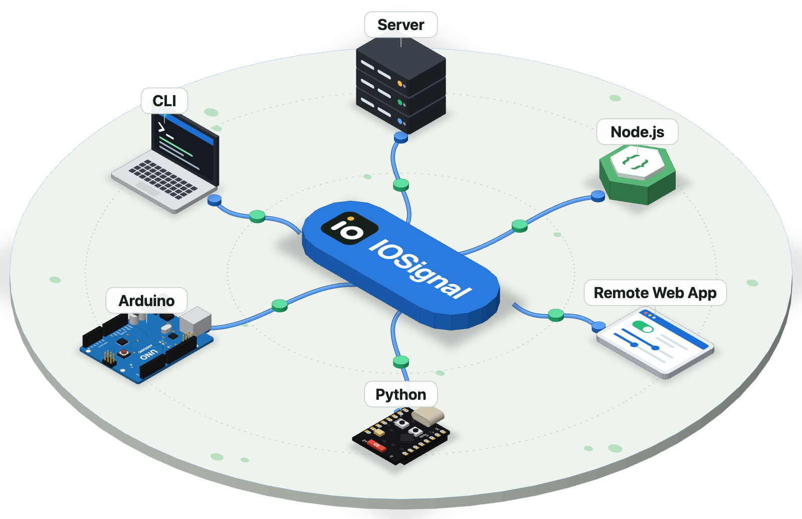

# IOSignal CLI

[한국어](README.md) | [English](README.en.md)

The CLI package version is **10.3.0** and uses IOSignal **10.3.0** or later. From 10.3.0 io-server limits nothing by default; turn quotas and connection limits on with `-q`, `--quotas` and `--connection-limits` ([Help and server output options](#help-and-server-output-options)). In 10.0.0 login and encryption moved to standard Ascon (boho 3), so logins are not compatible with 9.x clients and devices. Register device keys in auth files and Redis again with io-server 10.0.0 (anonymous connections are unchanged). 9.23.1 adds the `io-init` command, which creates a folder of example pages and virtual devices ([Starter folder: `io-init`](#starter-folder-io-init)). In 9.23.0 io-server serves, on the same port, a device control page (`--web`), your own pages (`--site`), virtual devices (`--devices`) and a dashboard (`--dashboard`), and there is a new `io-device` command ([Web pages and virtual devices](#web-pages-and-virtual-devices)). Since 9.0.0 authentication entries use a role and a quota profile instead of a level, and server output options were renamed. Coming from 8.x, see [Upgrading from 8.x](#upgrading-from-8x).

iosignal-cli runs an IOSignal server or an interactive client.

<p align="center">
  
</p>

## Installation

Requires Node.js 22.16.0 or later.

```sh
npm install -g iosignal-cli
```

The [iosignal-cli repository](https://github.com/remocons/iosignal-cli) holds this package and [remocon](https://www.npmjs.com/package/remocon) (`packages/iosignal-cli`, `packages/remocon`). For development, run from the repository root:

```sh
npm ci
npm test
node packages/iosignal-cli/bin/io-server.js --help
node packages/iosignal-cli/bin/io-client.js --help
```

Files both CLIs use (`ping.js`, `ping-line.js`, `log.js`) come from `shared/` at the root; `npm run sync:shared` copies them into each package's `lib/`, and `npm test` and publishing (`prepack`) do too.

### Upgrading from 8.x

9.0.0 contains breaking changes. The old server options now fail with an `unknown option` error.

| 8.x | 9.0.0 |
|---|---|
| `--timeout <ms>` | `-t, --heartbeat-interval <ms>` |
| `-m, --metric <mode>` (0-3) | `-m, --log-stats <ms>` (0, or 1000 and above; one summary line every N ms) |
| `-s, --show-message message` | `-s, --log-messages` (no value) |
| Auth entry `id.key.cid.level` | `id.key.cid[.role[.quota]]` |
| Auth file `[id, key, cid, level]` | `[id, key, cid, role?, quota?]` |
| Level-based quota table, enforced only when enabled | Every connection uses a quota profile; choose the unauthenticated one with `-q, --anonymous-quota` |

Map level numbers to roles. The old administrator entry `admin.admin-key.admin.255` becomes `admin.admin-key.admin.admin`. Only the `admin` role may use the `sudo` service.

## Running a server and client

```sh
io-server -l 7777                     # WebSocket server
io-server -L 8888                     # CongSocket (TCP) server
io-server -l 7777 -L 8888              # Enable both transports
io-client                            # Connect to ws://localhost:7777
io-client -c                         # Connect to wss://io.iosignal.net/ws
io-client -c ws://localhost:7777
io-client -c cong://localhost:8888
```

`ios` is an alias for `io-server`; `io` and `iosignal-cli` are aliases for `io-client`.
`ioip` prints local IPv4 addresses, and `io-keygen` generates candidate authentication IDs and keys.
Ports must be integers from 0 to 65535; 0 lets the operating system select a port.

The server's `-t, --heartbeat-interval` sets the liveness (heartbeat) check interval in milliseconds: 1000–2147483647, default 50000.
Specify at least one of `-l` or `-L` for the server. Without `-c`, the client connects to `ws://localhost:7777`.
Using `-c` or `--connect` without an address connects to the official server at `wss://io.iosignal.net/ws`.
You can combine this with other options, for example `io-client -c -j demo`.

## Help and server output options

```sh
io-client -h                    # Startup options and all interactive commands
io-server -h                    # Server options and examples
io-client -V                    # CLI and IOSignal versions
io-server -l 7777 -m 5000 -s
```

Type `help` while the client is running. Command names have no leading dot (`.`).
The old `.help`, `.sub`, and `.pub` syntax is unsupported; use `help`, `sub`, and `pub`. Command names are case-sensitive.
`-h` is a startup option used in the shell; `help` is an interactive command.

| Server option | Description |
| --- | --- |
| `-m, --log-stats <ms>` | Print a one-line summary (connections, channels, rates, memory) every N ms; 0: off (default), or 1000 and above |
| `-s, --log-messages` | Log the type and tag of each received message, never its payload |
| `-q, --anonymous-quota <limits\|profile>` | Limits for unauthenticated connections, such as `msgPerSec=100,maxMessageBytes=262144`, or a profile name from `--quotas`. No limits by default |
| `--quotas <file>` | JSON file of named quota profiles (`{ "basic": { "msgPerSec": 200 } }`) for the `quota` field of key entries and `-q <name>` |
| `--connection-limits <limits>` | Per public address connection limits (`maxPerAddress=200,newPerAddressPerMin=300`, …). None by default |
| `-f, --file-logger` | Write `connection.log`, `auth.log`, and `attack.log` in the current working directory |
| `-a, --attach-services [list...]` | Space-separated services: `reply`, `sudo`, `redis`; none by default |
| `-o, --show-options` | Print initial settings and registered service names |

Nothing is limited by default (from IOSignal 10.3.0; up to 10.2.0 unauthenticated connections used the 256 KiB, 100 messages/s `anonymous` profile). When you run a server in public, turn on the limits you need: `-q` for unauthenticated connections, profiles in a `--quotas` file with the `quota` field of key entries for logins, and `--connection-limits` per address.

Register built-in services when starting the server. For example, connect a client to this server and enter `call reply echo hello`:

```sh
io-server -l 7777 --attach-services reply
```

## Authentication

```sh
io-server -l 7777 --auth-file ./auth_file_sample/auth_file.json
io-client -i uno -k uno-key
```

See the [JSON example](auth_file_sample/auth_file.json) and [JavaScript example](auth_file_sample/auth_file.js) for authentication data formats.
A JSON file contains a list of `[id, key, cid, role?, quota?]` arrays. A JavaScript file provides the same list as the named export `authInfo`.
Example paths are relative to the cloned repository. After a global installation, specify the path to your own authentication file.
Command-line entries use `id.key.cid[.role[.quota]]`; separate multiple entries with commas.

- `role`: `device` (default), `service`, or `admin`. Only `admin` may use the `sudo` service.
- `quota`: the name of a profile in the `--quotas` file. Without it there are no limits.

```sh
io-server -l 7777 --auth-param 'uno.uno-key.uno,admin.admin-key.admin.admin'
io-client --auth-idKey uno.uno-key
```

Use both `-i` and `-k`, or use `-a id.key`. A complete `-i`/`-k` pair takes priority when both forms are supplied.
When multiple server authentication options are supplied, only one is selected in this order: `--auth-file` → `--auth-param` → `--auth-redis`.
Without authentication options, no authentication provider is configured.

The CLI does not print authentication keys supplied through startup options.
Command-line arguments may appear in shell history or process listings, so an authentication file is recommended for server credentials.

### Local test logins

`--id-key` and `--shared-key` turn on authentication without a key list. The login ID becomes the CID.

```sh
io-server -l 7777 -L 8888 --id-key        # log in when the key equals the ID
io-client -i dev1 -k dev1

io-server -l 7777 -k lab2026 -M           # any ID with the shared key; drop anonymous signals
io-client -i dev1 -k lab2026
```

| Option | Behavior |
| --- | --- |
| `-i, --id-key` | Any ID logs in when its key equals the ID |
| `-k, --shared-key <key>` | Any ID logs in with the shared key |
| `-M, --members-only` | Drop signals from connections that are not authenticated (also works with the other auth options) |

Anonymous connections are still accepted without `-M`. `--id-key` and `--shared-key` cannot be combined with each other or with another server authentication option.
Anyone who knows the rule can log in under any ID, so use them only for tests on a trusted local network.

## Subscribing and publishing

Start two clients and subscribe in the first:

```text
sub demo
```

Publish from the second:

```text
pub demo hello world
```

Use `io-client -j demo` or `io-client -j demo,alerts` to subscribe on startup.
`listen` and `join` are aliases for `subscribe`; received messages use the shared output handler.
These commands do not register a custom handler like the SDK's `io.listen(tag, handler)`.
Subscriptions are restored after reconnection and removed with `unsub`.
Interactive arguments are separated by whitespace; shell-style quoting is not interpreted.

| Command | Action |
| --- | --- |
| `help` | Show all interactive commands and usage notes |
| `sub <tag>` / `subscribe` / `listen` / `join` | Subscribe; separate multiple tags with commas |
| `unsub [tag]` | Unsubscribe from the specified tags, or all tags if omitted |
| `pub <tag> [args...]` / `publish` | Publish a message |
| `sig <tag> [args...]` / `signal` | Send a signal |
| `sig_bin <tag> <bytes>` | Send zero-filled binary data, 0–1048576 bytes; server quotas also apply |
| `call <target> <command> [args...]` | Call a service |
| `sudo <command> [args...]` | Call the sudo service; server permission required |
| `auth <id> <key>` / `login <id> <key>` | Configure automatic login / attempt login using the server's authentication challenge; a single `id.key` argument is also accepted |
| `hide` / `show` | Hide / show received channel and direct messages; control and status messages remain visible |
| `id` / `ch` / `quota` | Show the current connection (state, CID, authorization), subscriptions, or the applied quota |
| `ping` / `pong` | Ping the server / send a protocol pong to the server |
| `echo [text]` / `iam [name]` | Request an echo / query or set a nickname; text and name each use one token |
| `encNo` / `encYes` / `encAuto` / `encMode` | Change / inspect the encryption mode |
| `close` / `open [url]` / `connect [url]` | Close / reopen the connection; automatic reconnection may occur after `close` |
| `quit` / `exit` | Exit |

`open` keeps the transport selected at startup. Restart the client to switch between WS and TCP.
Stop the server with `Ctrl+C`. Stop the client with `exit`, `quit`, or `Ctrl+C`.
`exit` is a client command and cannot be used in the server.
For CongSocket reconnection, enter the full `cong://host:port` URL.
`hide` does not hide status or command responses. Echo and general status output are shown only in a TTY terminal.

Objects, binary data, and all payload arguments are displayed. Invalid interactive input prints an error and the CLI keeps running.

## Redis authentication and services

Requires a running Redis server. The default address is `localhost:6379`; environment variables can override it.

```sh
REDIS_HOST=127.0.0.1 REDIS_PORT=6379 io-server -l 7777 --auth-redis
io-server -l 7777 --auth-redis --attach-services reply redis
```

The server starts after Redis connects. A connection failure reports an error and exits with code 1.
The connection timeout is 5 seconds; automatic reconnection is disabled. Redis connections close when the server stops.

The [Redis authentication examples](test_auth_redis/) use the same environment variables.

```sh
node test_auth_redis/redis_addAdmin.js admin admin-key admin
node test_auth_redis/redis_addMultipleDevice.js uno 10
node test_auth_redis/redis_add_get_device.js
node test_auth_redis/server-auth-redis.js
```

The first three scripts write sample authentication data to Redis. The administrator example takes `<id> <key> <cid>` and registers it with the `admin` role.
The multiple-device example takes `<base_id> [count] [quota]` and creates `device` entries such as `uno0` to `uno9`, each with a key identical to its ID. A quota needs a profile of that name on the server (`--quotas`); without one there are no limits.
The administrator and multiple-device examples also call Redis `SAVE`. The server example uses WebSocket port 7777 by default.
One-off examples close Redis connections when finished and exit with code 1 on error.

## Web pages and virtual devices

io-server also serves web pages on its WebSocket port (`-l`). The device screens and rules come from the iosignal package (`iosignal/devices`).

```sh
io-server -l 7777 -L 8888 --web                     # device control page at http://<host>:7777/
io-server -l 7777 --web --site ./www                 # ./www served at /site/
io-server -l 7777 --web --devices ./devices          # run virtual devices
io-server -l 7777 --web --dashboard                  # server status page at /dashboard
io-device ./devices -c wss://io.iosignal.net/ws      # virtual devices on another broker, no server
```

### Starter folder: `io-init`

Creates a folder with example pages and virtual devices. Try it with npx, without a global install.

```sh
npx -p iosignal-cli io-init my-home      # create the folder (--port 8080, --arduino-port 0, --install)
cd my-home
npm install
npm start                                # io-server -l 7777 -L 55488 --web --site ./www --devices ./devices --dashboard
```

Open `http://localhost:7777/site/`. The folder holds:

- Pages (`www/`): the device panel, one category and single cards, finding devices and sending commands with `/lib/io.js` alone, and a 3D robot arm drawn with three.js (loaded from a CDN). The page text is in Korean.
- Virtual devices (`devices/`): a lamp, a fan, a thermo-hygrometer, a pump, a counter and a robot arm
- `package.json`: depends on this iosignal-cli version and provides `npm start` and `npm run devices` (devices only). `npm start` also opens CongSocket port 55488 for Arduino (the IOSignal Arduino default): set a board's server to this computer's address (`ioip`) and it shows up on the pages. Change it with `--arduino-port`; `0` leaves it closed.

It does not write into a folder that exists and is not empty.

- **`-w, --web`:** a page at `/` that finds and controls the devices of its home channel (the same public IP; on a LAN, the whole LAN).
  `--web-access members` makes the page ask for an ID and key before it connects (needs `-M`: the server keeps anonymous connections
  out, so devices log in too). `/#<cid>` goes to that device's card.
- **`--site <folder>`:** your own pages at `/site/` (`--home site` sends `/` there). They use `/components/` (the panel
  `<iosignal-devices>`, the card `<iosignal-device-card cid="...">`), `/shared/` (device rules), `/types/` (official types) and
  `/lib/io.js` (the browser client). `--cors` lets pages on other sites load them.
- **`--devices <path...>`:** each `*.device.js` / `*.device.json` file is one virtual device (one process). They connect over loopback,
  so they are in the LAN home channel. A changed file restarts its device (`--no-devices-watch` turns that off); an invalid file waits
  for a fix. Device code runs with io-server's rights: run only files you trust. Format: `io-device --help`; examples:
  `iosignal/devices/examples`.
- **`--dashboard [path]`:** the server status page (default `/dashboard`). `--dashboard-access`: `open` (default, for a LAN), `admin`
  (an admin account logs in), `token` (`IOSIGNAL_DASHBOARD_TOKEN`) or `token:<value>`. With `--devices` it lists the virtual devices.
- **`--trust-proxy`:** when `X-Forwarded-For` sets a client's address (and so its home channel): `private` (default: a proxy on the
  same host or a private network), `always`, `never`, or a number of proxy hops.
- `GET /healthz` answers `{"status":"ok"}` (for container health checks). A port already in use ends io-server with
  `port N is already in use`.

## Docker

The image `ghcr.io/remocons/iosignal` (amd64, arm64, Raspberry Pi arm/v7 and arm/v6) runs io-server. Without arguments it serves the device control page, example pages (`/site/`) CongSocket 55488 for Arduino and a virtual robot arm and lamp; the dashboard comes on with `IOSIGNAL_DASHBOARD_TOKEN`, all example devices with `IOSIGNAL_DEVICES=1`, and no virtual devices with `IOSIGNAL_DEVICES=0`.

```sh
docker run --rm -p 7777:7777 -p 55488:55488 ghcr.io/remocons/iosignal
```

Usage and building are in the repository's [docker/README.en.md](https://github.com/remocons/iosignal-cli/blob/main/docker/README.en.md).

## Tests

`npm test` checks option validation and real local WebSocket communication.
Set `IOSIGNAL_TEST_REDIS_SERVER` to a Redis executable to start a temporary Redis instance and test authentication examples, authentication-key output, connection failures, and clean shutdown.
Existing Redis data is not used.

```sh
IOSIGNAL_TEST_REDIS_SERVER=redis-server npm test
```

## Interactive logs and ping

The interactive prompt uses `›` instead of the CID. Responses are indented, and received messages, connection status, and errors are distinguished.
Timestamps are hidden by default; enable them with `--timestamps`.
Set `NO_COLOR=1` to disable colors. Piped output has no decorations or timestamps.

`ping` requests a server response. Peer ping (`ping <cid>`, `pping`) was removed.
The reply is one line: `⠋ ping …` turns while waiting, then the same line becomes `✓ pong 23 ms`, or `✗ ping timeout · 3 s` after 3 seconds without one. The same ping entered again updates that line instead of adding one: `✓ pong 21 ms · 6회 · 평균 23 ms  ▂▃▂▅▂▃`. When the output is not a terminal, each reply is one `pong 23 ms` line. Replies to the client's own keep-alive pings are not shown. Disconnecting cancels pending requests.
The Node CLI handles both legacy WebSocket control PONG frames and IOSignal PONG packets.
The browser CLI's default ping requires an IOSignal PONG packet from the server.
