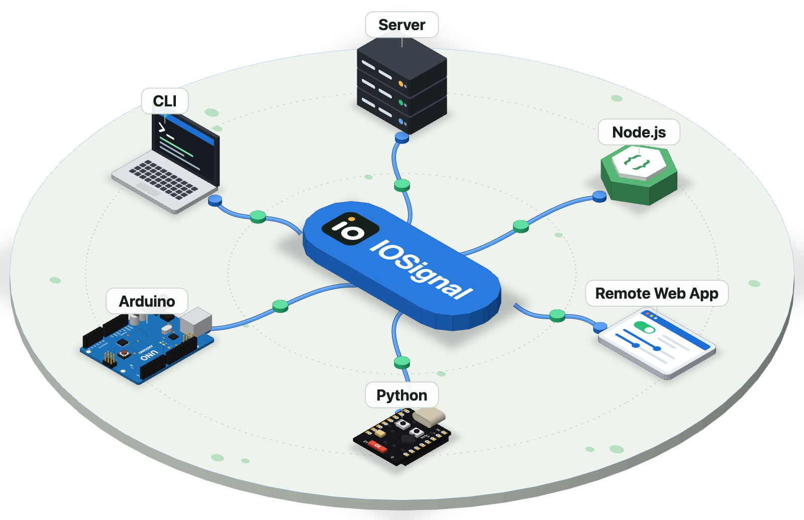

# IOSignal CLI

[한국어](README.md) | [English](README.en.md)

CLI 패키지 버전은 **10.3.1**이며, IOSignal **10.3.0** 이상을 사용합니다. 10.3.0부터 io-server는 기본으로 아무것도 제한하지 않습니다. 쿼터와 연결 제한은 `-q`, `--quotas`, `--connection-limits`로 켭니다([도움말과 서버 출력 옵션](#도움말과-서버-출력-옵션)). 10.0.0에서 로그인과 암호화가 표준 Ascon(boho 3)으로 바뀌어 9.x 클라이언트·장치와 로그인 호환이 되지 않습니다. 인증 파일과 Redis에 저장한 장치 키는 io-server 10.0.0에서 다시 등록하세요(익명 접속은 그대로). 9.23.1에서 페이지와 가상 장치 예제 폴더를 만드는 `io-init` 명령이 생겼습니다([시작용 폴더 `io-init`](#시작용-폴더-io-init)). 9.23.0에서 io-server는 같은 포트로 장치 제어 페이지(`--web`), 직접 만든 페이지(`--site`), 가상 장치(`--devices`), 대시보드(`--dashboard`)를 함께 제공하고, `io-device` 명령이 생겼습니다([웹 페이지와 가상 장치](#웹-페이지와-가상-장치)). 9.0.0부터 인증 항목의 레벨이 역할(role)과 쿼터 프로필(quota)로 바뀌었고, 서버 출력 옵션 이름이 바뀌었습니다. 8.x에서 올라온다면 [8.x에서 업그레이드](#8x에서-업그레이드)를 확인하세요.

iosignal-cli는 IOSignal 서버와 대화형 클라이언트를 실행하는 CLI입니다.

<p align="center">
  
</p>

## 설치

Node.js 22.16.0 이상이 필요합니다.

```sh
npm install -g iosignal-cli
```

[iosignal-cli 저장소](https://github.com/remocons/iosignal-cli)는 이 패키지와 [remocon](https://www.npmjs.com/package/remocon)을 함께 둡니다(`packages/iosignal-cli`, `packages/remocon`). 저장소에서 개발할 때는 저장소 루트에서 다음 명령을 사용합니다.

```sh
npm ci
npm test
node packages/iosignal-cli/bin/io-server.js --help
node packages/iosignal-cli/bin/io-client.js --help
```

두 CLI가 함께 쓰는 파일(`ping.js`, `ping-line.js`, `log.js`)은 루트의 `shared/`가 원본이고, `npm run sync:shared`가 각 패키지의 `lib/`로 복사합니다. `npm test`와 배포(`prepack`) 때도 복사합니다.

### 8.x에서 업그레이드

9.0.0은 호환되지 않는 변경을 포함합니다. 이전 서버 옵션은 `unknown option` 오류로 실행되지 않습니다.

| 8.x | 9.0.0 |
|---|---|
| `--timeout <ms>` | `-t, --heartbeat-interval <ms>` |
| `-m, --metric <mode>` (0~3) | `-m, --log-stats <ms>` (0 또는 1000 이상, N밀리초마다 요약 한 줄) |
| `-s, --show-message message` | `-s, --log-messages` (값 없음) |
| 인증 항목 `id.key.cid.level` | `id.key.cid[.role[.quota]]` |
| 인증 파일 `[id, key, cid, level]` | `[id, key, cid, role?, quota?]` |
| 레벨별 quota 표, 서버 설정에 따라 적용 여부 결정 | 모든 연결에 쿼터 프로필 적용, 미인증 연결은 `-q, --anonymous-quota`로 선택 |

레벨 숫자는 역할로 옮깁니다. 예전 관리자 항목(`admin.admin-key.admin.255`)은 `admin.admin-key.admin.admin`이 됩니다. `sudo` 서비스는 `admin` 역할만 쓸 수 있습니다.

## 서버와 클라이언트 실행

```sh
io-server -l 7777                     # WebSocket 서버
io-server -L 8888                     # CongSocket(TCP) 서버
io-server -l 7777 -L 8888              # 두 전송 방식 함께 사용
io-client                            # ws://localhost:7777 연결
io-client -c                         # 공식 서버 wss://io.iosignal.net/ws 연결
io-client -c ws://localhost:7777
io-client -c cong://localhost:8888
```

`ios`는 `io-server`의 별칭이고, `io`와 `iosignal-cli`는 `io-client`의 별칭입니다.
`ioip`는 로컬 IPv4 주소를 출력하고, `io-keygen`은 인증용 ID와 키 후보를 생성합니다.
포트는 0~65535 정수이며, 0은 운영체제가 포트를 선택하도록 합니다.

서버의 `-t, --heartbeat-interval`은 연결 확인(heartbeat) 주기입니다. 밀리초 단위이며 1000~2147483647 범위를 받습니다(기본 50000).
서버는 `-l`, `-L` 중 하나 이상을 지정해야 합니다. 클라이언트는 `-c` 옵션을 생략하면 `ws://localhost:7777`을 사용합니다.
`-c` 또는 `--connect`만 지정하고 주소를 생략하면 공식 서버 `wss://io.iosignal.net/ws`에 접속합니다.
`io-client -c -j demo`처럼 다른 옵션과 함께 사용할 수도 있습니다.

## 도움말과 서버 출력 옵션

```sh
io-client -h                    # 시작 옵션과 전체 대화형 명령
io-server -h                    # 서버 옵션과 실행 예제
io-client -V                    # CLI 및 IOSignal 버전
io-server -l 7777 -m 5000 -s
```

클라이언트 실행 중에는 `help`를 입력합니다. 명령 앞에 점(`.`)을 붙이지 않습니다.
기존 `.help`, `.sub`, `.pub` 같은 문법은 지원하지 않으며, 각각 `help`, `sub`, `pub`로 바꿔 입력하세요. 명령 이름은 대소문자를 구분합니다.
`-h`는 셸에서 프로그램을 실행할 때 쓰는 옵션이며, `help`는 실행 중 입력하는 명령입니다.

| 서버 옵션 | 설명 |
|---|---|
| `-m, --log-stats <ms>` | N밀리초마다 연결·채널·초당 처리량·메모리 요약 한 줄 출력 (0: 끔(기본), 1000 이상) |
| `-s, --log-messages` | 수신 메시지의 종류와 태그 로그 (내용은 출력하지 않음) |
| `-q, --anonymous-quota <limits\|profile>` | 미인증 연결 제한. `msgPerSec=100,maxMessageBytes=262144`처럼 값을 주거나 `--quotas`의 프로필 이름. 기본은 제한 없음 |
| `--quotas <file>` | 이름 붙인 쿼터 프로필 JSON 파일(`{ "basic": { "msgPerSec": 200 } }`). 인증 항목의 `quota`와 `-q <이름>`이 씀 |
| `--connection-limits <limits>` | 공인 주소별 연결 제한(`maxPerAddress=200,newPerAddressPerMin=300` 등). 기본은 없음 |
| `-f, --file-logger` | 현재 작업 디렉터리에 `connection.log`, `auth.log`, `attack.log` 기록 |
| `-a, --attach-services [list...]` | `reply`, `sudo`, `redis` 중 공백으로 구분하여 지정; 기본은 없음 |
| `-o, --show-options` | 초기 설정과 등록된 서비스 이름 출력 |

기본으로는 아무것도 제한하지 않습니다(IOSignal 10.3.0부터. 10.2.0까지는 미인증 연결에 256 KiB·초당 100개 `anonymous` 프로필이 적용됨). 공개된 곳에서 운영한다면 필요한 제한을 직접 켭니다: 미인증 연결은 `-q`, 로그인한 연결은 `--quotas` 파일의 프로필과 인증 항목의 `quota`, 주소별 연결 수는 `--connection-limits`.

내장 서비스를 호출하려면 서버 시작 시 등록해야 합니다. 예를 들어 다음 서버에 클라이언트로 접속한 뒤 `call reply echo hello`를 입력합니다.

```sh
io-server -l 7777 --attach-services reply
```

## 인증

```sh
io-server -l 7777 --auth-file ./auth_file_sample/auth_file.json
io-client -i uno -k uno-key
```

인증 데이터 형식은 [JSON 예제](auth_file_sample/auth_file.json)와
[JavaScript 예제](auth_file_sample/auth_file.js)를 참고하세요.
JSON 파일은 `[id, key, cid, role?, quota?]` 배열들의 목록이며, JavaScript 파일은 같은 목록을 `authInfo`로 named export합니다.
예제 파일 경로는 이 저장소를 내려받은 디렉터리를 기준으로 합니다. 전역 설치 후에는 준비한 인증 파일의 경로를 지정하세요.
명령 인자로 지정할 때는 `id.key.cid[.role[.quota]]` 형식을 사용하고, 여러 항목은 쉼표로 구분합니다.

- `role`: `device`(기본), `service`, `admin`. `sudo` 서비스는 `admin`만 쓸 수 있습니다.
- `quota`: `--quotas` 파일에 있는 쿼터 프로필 이름. 생략하면 제한이 없습니다.

```sh
io-server -l 7777 --auth-param 'uno.uno-key.uno,admin.admin-key.admin.admin'
io-client --auth-idKey uno.uno-key
```

클라이언트는 `-i`와 `-k`를 함께 사용하거나 `-a id.key`를 사용합니다. 둘 다 주어지면 완전한 `-i`/`-k` 쌍이 우선합니다.
서버 인증 옵션을 함께 지정하면 `--auth-file` → `--auth-param` → `--auth-redis` 순서로 하나만 선택됩니다.
인증 옵션이 없으면 인증 제공자를 설정하지 않습니다.

CLI는 시작 옵션에 포함된 인증 키를 출력하지 않습니다.
명령행 인자는 셸 이력이나 프로세스 목록에 남을 수 있으므로 서버 인증 정보는 파일 사용을 권장합니다.

### 로컬 테스트 로그인

키 목록 없이 인증을 켜려면 `--id-key` 또는 `--shared-key`를 사용합니다. 로그인 ID가 그대로 CID가 됩니다.

```sh
io-server -l 7777 -L 8888 --id-key        # 키가 ID와 같으면 로그인
io-client -i dev1 -k dev1

io-server -l 7777 -k lab2026 -M           # 아무 ID + 공통 키, 익명 시그널 차단
io-client -i dev1 -k lab2026
```

| 옵션 | 동작 |
| --- | --- |
| `-i, --id-key` | 키가 ID와 같은 모든 ID 로그인 |
| `-k, --shared-key <key>` | 공통 키를 가진 모든 ID 로그인 |
| `-M, --members-only` | 인증하지 않은 연결의 시그널 차단 (다른 인증 옵션과도 함께 사용 가능) |

익명 연결은 `-M` 없이도 계속 접속할 수 있습니다. `--id-key`와 `--shared-key`는 서로, 또는 다른 서버 인증 옵션과 함께 쓸 수 없습니다.
규칙을 아는 누구나 임의 ID로 로그인할 수 있으므로 신뢰하는 로컬 네트워크의 테스트에만 사용하세요.

## 구독과 발행

두 클라이언트를 실행한 뒤 첫 번째 클라이언트에서 구독합니다.

```text
sub demo
```

두 번째 클라이언트에서 발행합니다.

```text
pub demo hello world
```

`io-client -j demo` 또는 `io-client -j demo,alerts`로 시작 시 구독할 수도 있습니다.
`listen`과 `join`은 `subscribe`의 별칭이며, 공통 수신 핸들러로 출력합니다.
SDK의 `io.listen(tag, handler)`처럼 사용자 핸들러를 등록하는 명령은 아닙니다.
구독 목록은 재접속 시 복원되며 `unsub`로 제거합니다.
대화형 명령의 인자는 공백으로 나누며, 셸처럼 따옴표를 해석하지 않습니다.

| 명령 | 동작 |
|---|---|
| `help` | 전체 대화형 명령과 사용상 주의 표시 |
| `sub <tag>` / `subscribe` / `listen` / `join` | 구독, 여러 태그는 쉼표로 구분 |
| `unsub [tag]` | 지정 태그 구독 취소, 생략하면 전체 취소 |
| `pub <tag> [args...]` / `publish` | 메시지 발행 |
| `sig <tag> [args...]` / `signal` | 신호 전송 |
| `sig_bin <tag> <bytes>` | 0으로 채운 바이너리 전송, 0~1048576바이트; 서버 quota는 별도 적용 |
| `call <target> <command> [args...]` | 서비스 호출 |
| `sudo <command> [args...]` | sudo 서비스 호출; 서버 권한 필요 |
| `auth <id> <key>` / `login <id> <key>` | 자동 로그인용 인증 설정 / 서버 인증 challenge를 이용한 로그인 시도; 단일 `id.key` 인자도 가능 |
| `hide` / `show` | 수신 message 및 CID 메시지 숨김 / 표시; 제어·상태 메시지는 유지 |
| `id` / `ch` / `quota` | 현재 연결(상태, CID, 인증 여부), 구독, 적용 중인 quota 조회 |
| `ping` / `pong` | 서버 ping · 서버로 pong 전송 |
| `echo [text]` / `iam [name]` | echo 요청 / 별명 조회·설정; text와 name은 한 토큰 |
| `encNo` / `encYes` / `encAuto` / `encMode` | 암호화 모드 변경 / 조회 |
| `close` / `open [url]` / `connect [url]` | 연결 닫기 / 재연결; `close` 후 자동 재접속할 수 있음 |
| `quit` / `exit` | 종료 |

`open`은 시작 시 선택한 전송 방식을 유지합니다. WS/TCP를 바꾸려면 클라이언트를 다시 실행하세요.
서버는 `Ctrl+C`로 종료하고, 클라이언트는 `exit`, `quit` 또는 `Ctrl+C`로 종료합니다.
`exit`는 클라이언트의 대화형 명령이며 서버에서는 사용할 수 없습니다.
CongSocket 재접속 주소는 `cong://host:port` 전체 형식으로 입력합니다.
`hide`는 상태나 명령 응답을 숨기지 않습니다. echo 및 일반 상태 출력은 TTY 터미널에서만 표시됩니다.

객체, 바이너리, 여러 payload 인자를 모두 표시합니다. 잘못된 대화형 입력은 오류를 출력하며 CLI는 계속 실행됩니다.

## Redis 인증과 서비스

실행 중인 Redis가 필요합니다. 기본 주소는 `localhost:6379`이며 환경변수로 변경할 수 있습니다.

```sh
REDIS_HOST=127.0.0.1 REDIS_PORT=6379 io-server -l 7777 --auth-redis
io-server -l 7777 --auth-redis --attach-services reply redis
```

Redis 연결이 완료된 뒤 서버를 시작하며, 연결 실패 시 오류와 종료 코드 1을 반환합니다.
연결 제한 시간은 5초이며 자동 재접속은 사용하지 않습니다. 서버 종료 시 Redis 연결도 닫습니다.

[Redis 인증 예제](test_auth_redis/)는 같은 환경변수를 사용합니다.

```sh
node test_auth_redis/redis_addAdmin.js admin admin-key admin
node test_auth_redis/redis_addMultipleDevice.js uno 10
node test_auth_redis/redis_add_get_device.js
node test_auth_redis/server-auth-redis.js
```

앞의 세 스크립트는 Redis에 예제 인증 데이터를 기록합니다. 관리자 예제는 `<id> <key> <cid>`를 받아 `admin` 역할로 등록합니다.
다중 장치 예제는 `<base_id> [count] [quota]`를 받아 `uno0`~`uno9`처럼 ID와 같은 키를 가진 `device` 역할 항목을 만듭니다. quota를 주면 서버에 같은 이름의 프로필(`--quotas`)이 있어야 하고, 생략하면 제한이 없습니다.
관리자·다중 장치 예제는 Redis `SAVE`도 호출합니다. 서버 예제의 기본 WebSocket 포트는 7777입니다.
단발성 예제는 작업 완료 후 Redis 연결을 닫고, 오류가 발생하면 종료 코드 1을 반환합니다.

## 웹 페이지와 가상 장치

io-server는 WebSocket 포트(`-l`)에서 웹 페이지도 제공합니다. 장치 화면과 규칙은 iosignal 패키지의 `iosignal/devices`에서 옵니다.

```sh
io-server -l 7777 -L 8888 --web                     # http://<주소>:7777/ 장치 제어 페이지
io-server -l 7777 --web --site ./www                 # ./www를 /site/로 제공
io-server -l 7777 --web --devices ./devices          # 가상 장치 실행
io-server -l 7777 --web --dashboard                  # /dashboard 서버 상태 페이지
io-device ./devices -c wss://io.iosignal.net/ws      # 서버 없이 다른 브로커에 가상 장치만
```

### 시작용 폴더 `io-init`

페이지와 가상 장치 예제가 든 폴더를 만듭니다. 전역 설치 없이 npx로 바로 시험할 수 있습니다.

```sh
npx -p iosignal-cli io-init my-home      # 폴더 만들기 (--port 8080, --arduino-port 0, --install)
cd my-home
npm install
npm start                                # io-server -l 7777 -L 55488 --web --site ./www --devices ./devices --dashboard
```

`http://localhost:7777/site/`를 엽니다. 폴더에는 다음이 들어 있습니다.

- 페이지(`www/`): 장치 패널, 분류·카드 하나씩, 컴포넌트 없이 `/lib/io.js`로 찾기·명령 보내기, three.js로 그린 3D 로봇 팔 조종(three.js는 CDN에서 받음)
- 가상 장치(`devices/`): 조명, 선풍기, 온습도계, 펌프, 카운터, 로봇 팔
- `package.json`: 이 버전의 iosignal-cli를 의존성으로 두고 `npm start`, `npm run devices`(장치만)를 제공. `npm start`는 아두이노용 CongSocket 포트 55488(IOSignal Arduino의 기본 포트)도 엽니다. 보드의 서버를 이 컴퓨터 주소(`ioip`)로 두면 페이지에 장치로 나옵니다. `--arduino-port`로 바꾸고, `0`이면 열지 않습니다.

이미 있고 비어 있지 않은 폴더에는 만들지 않습니다.

- **`-w, --web`:** `/`에 같은 홈채널(같은 공인 IP, LAN이면 LAN 전체)의 장치를 찾아 제어하는 페이지. `--web-access members`는 페이지가
  ID와 키를 받은 뒤 접속합니다(`-M` 필요: 서버가 익명 연결을 막고, 장치도 로그인해야 합니다). `/#<cid>`는 그 장치 카드로 이동합니다.
- **`--site <폴더>`:** 직접 만든 페이지를 `/site/`로 제공합니다(`--home site`면 `/`가 이리로 이동). 페이지는 `/components/`(장치 패널
  `<iosignal-devices>`, 카드 `<iosignal-device-card cid="...">`), `/shared/`(장치 규칙), `/types/`(공식 타입), `/lib/io.js`(브라우저
  클라이언트)를 씁니다. 다른 사이트의 페이지가 이 파일을 불러오려면 `--cors`.
- **`--devices <경로...>`:** `*.device.js` / `*.device.json` 파일 하나가 가상 장치 하나(프로세스 하나)입니다. 루프백으로 접속하므로
  LAN 홈채널에 보입니다. 파일을 고치면 다시 시작하며(`--no-devices-watch`로 끔), 잘못된 파일은 고칠 때까지 기다립니다. 장치 코드는
  io-server와 같은 권한으로 실행되니 믿을 수 있는 파일만 쓰세요. 형식은 `io-device --help`, 예제는 `iosignal/devices/examples`.
- **`--dashboard [경로]`:** 서버 상태 페이지(기본 `/dashboard`). `--dashboard-access`는 `open`(기본, LAN용), `admin`(admin 계정 로그인),
  `token`(`IOSIGNAL_DASHBOARD_TOKEN`) 또는 `token:<값>`. `--devices`를 쓰면 가상 장치 표가 함께 나옵니다.
- **`--trust-proxy`:** 접속 주소(그리고 홈채널)를 정할 때 `X-Forwarded-For`를 믿을지: `private`(기본, 같은 호스트·사설망의 프록시),
  `always`, `never`, 또는 프록시 단계 수.
- `GET /healthz`는 `{"status":"ok"}`로 답합니다(컨테이너 헬스체크용). 포트가 이미 쓰이면 `port N is already in use`를 출력하고 끝납니다.

## Docker

io-server를 담은 이미지 `ghcr.io/remocons/iosignal`(amd64, arm64, 라즈베리파이 arm/v7·arm/v6)이 있습니다. 인자 없이 실행하면 장치 제어 페이지, 예제 페이지(`/site/`), Arduino용 CongSocket 55488, 가상 로봇 팔과 조명이 켜집니다. 대시보드는 `IOSIGNAL_DASHBOARD_TOKEN`을 줄 때, 예제 가상 장치 전부는 `IOSIGNAL_DEVICES=1`, 가상 장치 없이는 `IOSIGNAL_DEVICES=0`입니다.

```sh
docker run --rm -p 7777:7777 -p 55488:55488 ghcr.io/remocons/iosignal
```

자세한 사용법과 빌드는 저장소의 [docker/README.md](https://github.com/remocons/iosignal-cli/blob/main/docker/README.md)에 있습니다.

## 테스트

`npm test`는 옵션 검증과 실제 로컬 WebSocket 통신을 검사합니다.
`IOSIGNAL_TEST_REDIS_SERVER`에 Redis 실행 파일을 지정하면 임시 Redis 인스턴스를 생성하여 인증 예제, 인증 키 출력 여부,
연결 실패 및 정상 종료까지 검증할 수 있습니다. 기존 Redis 데이터는 사용하지 않습니다.

```sh
IOSIGNAL_TEST_REDIS_SERVER=redis-server npm test
```

## 대화형 로그와 ping

대화형 프롬프트는 CID 대신 `›`를 사용합니다. 응답은 들여쓰고 수신 메시지,
연결 상태, 오류를 구분합니다. 시간은 기본적으로 숨기며 `--timestamps`로 표시합니다.
`NO_COLOR=1`로 색상을 끌 수 있습니다. 파이프 출력에는 장식이나 시간이 추가되지 않습니다.

`ping`은 서버에 응답을 요청합니다. 상대 장치에 보내던 peer ping(`ping <cid>`, `pping`)은 없앴습니다.
응답은 한 줄로 표시합니다. 기다리는 동안 `⠋ ping …`이 돌다가 같은 자리에 `✓ pong 23 ms`로 바뀌고, 3초 동안 응답이 없으면 `✗ ping timeout · 3 s`로 바뀝니다. 같은 ping을 연달아 입력하면 줄을 늘리지 않고 `✓ pong 21 ms · 6회 · 평균 23 ms  ▂▃▂▅▂▃`처럼 그 줄을 갱신합니다. 출력이 터미널이 아니면 응답마다 `pong 23 ms` 한 줄을 씁니다. 클라이언트가 연결 유지를 위해 스스로 보내는 ping의 응답은 표시하지 않습니다.
연결이 끊기면 대기 중인 ping 요청을 취소합니다.
Node CLI는 기존 서버의 WebSocket 제어 PONG과 IOSignal PONG 패킷을 모두 처리합니다.
브라우저 CLI의 기본 ping에는 서버의 IOSignal PONG 패킷 응답이 필요합니다.
